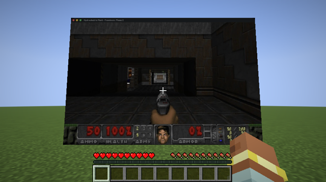

# Mac Arcade: any Mac app on a playable screen inside Minecraft

`um mac stream` captures any macOS window with ScreenCaptureKit and serves it as live JPEG frames on `127.0.0.1`.
This Fabric mod (Minecraft 26.3) draws those frames on a giant in-world screen, and in play mode it sends your
keys and mouse back to the app. The guest app is never modified or injected, so it works with any windowed Mac app.

<p align="center"></p>

## Use it
```bash
um mac stream --app UZDoom          # or any app: --app Safari, --pid 1234, --window <id>
./gradlew runClient                 # dev client, no Microsoft account
```
In game:
- `/arcade here` puts the screen 4.5 blocks in front of you.
- `/arcade play` sends your input to the guest. Press **Right Shift** to stop.
- `/arcade off` removes the screen.

Background games: turn App Nap off for the guest (`defaults write <bundle id> NSAppSleepDisabled -bool YES`), or
macOS freezes it once Minecraft is in front.

## Status (macOS 26.6, M5 Max)
| | |
|---|---|
| Live video into Minecraft | **verified**: client game test, about 80 frames in 4 s at 640×432, with screenshots |
| Play-mode screen | **verified**: it opens and renders |
| Input to the guest (`CGEvent.postToPid`) | **untested**: it needs Accessibility for the app running `um mac stream` |
| Guest keeps animating behind Minecraft | depends on the guest. UZDoom ran in the background with App Nap off, but a scripted UZDoom guest sometimes crashes at startup (an SDL controller-init race), so the automated motion check is logged, not required |

`./verify.sh` runs the whole chain: a Freedoom guest, then `um mac stream`, then `runClientGameTest`.
